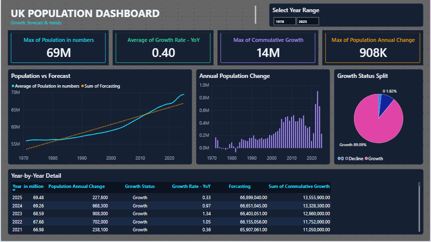

# UK Population Dashboard

I built this Power BI report to explore UK population figures over time. I brought population, annual change and growth indicators together so they can be viewed on one page.

## Dashboard preview

## What is in the report

- A year slicer.
- Cards for population, year-on-year growth rate, cumulative growth and annual population change.
- A line chart showing population and the dataset's forecasting field by year.
- A column chart showing annual population change by year.
- A pie chart counting years by growth status.
- A table with the yearly figures, population in millions, annual change, growth status, growth rate, forecasting and cumulative growth.

## Reading the figures

The population, cumulative-growth and annual-change cards use the maximum value in the current selection. The growth-rate card uses the average. When several years are selected, these cards should not all be read as figures for the latest year.

The forecast line uses a field already present in the data. This report does not establish how that forecast was produced or validate its accuracy.

## What I practised

I worked on time-based charts, summary cards, a detailed table and filtering by year. I also practised showing absolute population changes alongside percentage growth.

## Open the report

Download [UK_POPULATION_dashboard_v2.pbix](UK_POPULATION_dashboard_v2.pbix) and open it in Power BI Desktop. Use the year slicer to explore the figures.

The PBIX contains the saved report and data model. The original source files are not included, so refreshing the data may require updating the source connection in Power Query.

## About this project

This is part of my Power BI learning portfolio. The figures reflect the dataset saved in the file and should not be treated as a live population update.
